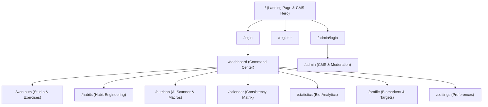

# HAbyTAT Platform — Comprehensive Architecture & Systems Report

## 1. Executive Summary
**HAbyTAT** is an intelligent, full-stack fitness, habit engineering, and metabolic nutrition platform. It provides athletes, high-performers, and individuals with a cohesive digital environment to track physical workouts, build daily discipline habits, scan and log nutrition, monitor bio-telemetry, and analyze longitudinal wellness trends.

```
       ┌────────────────────────────────────────────────────────┐
       │                   HAbyTAT Ecosystem                    │
       ├───────────────────┬────────────────────────────────────┤
       │  User Experience  │  Admin Control Plane (CMS)         │
       │  • Dashboard      │  • Dynamic Site Content & Hero     │
       │  • Workouts       │  • Broadcast Notifications         │
       │  • Habits         │  • User Moderation & Security      │
       │  • Nutrition      │  • System Telemetry Audits         │
       │  • Analytics      │                                    │
       └───────────────────┴────────────────────────────────────┘
```

---

## 2. Technology Stack & Infrastructure

| Layer | Technology | Key Dependencies / Features |
| :--- | :--- | :--- |
| **Frontend Runtime** | React 18 (Vite 5) | Single Page Application (SPA), HMR, Code-splitting |
| **Routing & State** | `react-router-dom` v6 | `AuthProvider`, `ThemeProvider`, Protected & Admin Routes |
| **Styling & Aesthetics** | Custom Vanilla CSS + Tailwind | Adaptive obsidian dark (`#080A12`) & clean slate light mode |
| **3D & Visuals** | Three.js / Canvas Confetti / Lucide | 3D interactive hero scenes, procedural particle confetti |
| **Backend Runtime** | Node.js (Express REST API) | MVC Architecture with decoupled Service & Controller layers |
| **Database & ODM** | MongoDB (Mongoose) | Normalized schemas with relational indexes and cascades |
| **Security & Auth** | JWT + Bcrypt + RBAC | Role-Based Access Control (`USER`, `ADMIN`), Bearer token auth |
| **Static Assets** | Vite Public Pipeline | Custom photorealistic discipline & exercise photography |

---

## 3. Comprehensive Sitemap & Page Breakdown



### 1. Landing Page (`/`)
- **Ambient Cloud Video**: Ultra-high definition background loop with dynamic gradient vignette.
- **CMS Hero Editor**: Headlines, subtitles, and CTA links dynamically populated from MongoDB via Admin settings.
- **Global Broadcast Bar**: Real-time announcement banner controlled by system admins with instant dismissibility.
- **Promotional Pills**: Dynamic ad and spotlight links configured via JSON in the admin CMS.

### 2. Interactive Authentication (`/login` & `/register`)
- **3D Canvas Interactive Scenes**: Built with Three.js (`AuthScene3D`, `HabitHeroVisual3D`) providing dynamic tilt cards, depth floating badges, and reactive lighting.
- **Password Strength Evaluation**: Live client-side cryptographic complexity meter assessing length, entropy, digits, and symbols.
- **Form State Management**: Instant validation, loading spinners, and error alerts.

### 3. Personal Command Center (`/dashboard`)
- **Daily Activity Rings**:
  - **Move Ring**: Dynamic active energy burn calculated directly from logged workouts and step cadence.
  - **Exercise Ring**: Real-time active minutes aggregated across cardio, strength, and interval sessions.
  - **Stand / Cadence Ring**: Pacing and hourly movement consistency.
  - **Dual Mode Header Toggle**: Instant toggle between `Active Burn` (calories expended) and `Dietary Fuel` (macronutrient energy intake).
- **Step Cadence Tracker**:
  - Incremental step logger with real-time distance (`km`), calorie conversion, and active minutes generation.
  - **Withdraw Control**: Undo accidental step entries with automatic recalculation of daily rings.
- **Hydration Tracker**:
  - Visual water intake fill bar with +/- 250ml quick-log buttons.
  - Withdrawal feature to decrement water count.
  - Progress bar tied directly to user profile hydration goals.
- **Vitality Score**: Comprehensive composite score (0–100) aggregating habit completion rate, workout volume, sleep targets, and nutrition balance.
- **Personal Records & Achievements**: Badges for milestone streaks, weightlifting personal records, and distance milestones.

### 4. Workout Styles & Exercise Studio (`/workouts`)
- **Discipline Gallery**: 8 distinct athletic styles (Road & Track Running, Strength & Hypertrophy, HIIT & Tabata, Calisthenics, Vinyasa Yoga, Cycling, Boxing, Brisk Walking & Rucking).
- **Curated Exercise Studio with Photography**:
  - Photorealistic demonstration imagery for each exercise (`deadlift.jpg`, `squat.jpg`, `bench.jpg`, `pullups.jpg`, `battle_ropes.jpg`, etc.).
  - Prescribed volume protocols (`sets x reps` or `work / rest` intervals).
  - Biomechanical execution instructions and target kinetic chain tags.
- **Interactive Workout Checklist**: Athletes check off individual exercises during live training with dynamic strike-throughs and `X/Y Complete` counters.
- **Real-Time Stopwatch & Bio-Telemetry**:
  - Interval timer with Start, Pause, Resume, and Stop states.
  - Dynamic pace calculation (`min'sec"/km`) and calories modeled via discipline-specific burn rates.
  - **5-Tier Heart Rate Zones**: Zone 1 (Active Recovery) through Zone 5 (Peak Anaerobic).
  - **GPS Route Visualizer vs. EPOC Indoor Board**: Route map for outdoor cardio vs. set counters for indoor lifting.
- **Deep-Dive Protocol Guide**: Modal displaying training methodology, biological benefits, and 1-click routine launcher.
- **Session History Manager**: Instant backend sync with MongoDB, celebratory confetti on completion, and session deletion.

### 5. Habit Engineering Hub (`/habits`)
- **Categorization**: Habits organized under Health, Fitness, Mindfulness, Productivity, and Custom categories.
- **Cadence Rules**: Daily, weekly, or specific recurring day intervals.
- **Streak Engine**: Real-time streak calculation with current streak, best historical streak, and completion velocity.
- **Micro-Interactions**: Custom checkbox animations with particle bursts upon 100% daily completion.
- **Habit Controls**: Quick edit modal, archiving, and deletion safeguards.

### 6. AI Nutrition Scanner & Macro Tracker (`/nutrition`)
- **AI Food & Meal Scanner**:
  - Camera integration for direct snapshot analysis.
  - Photo upload with automated macronutrient breakdown (calories, protein, carbohydrates, fats).
- **Barcode Scanner**: Integrated barcode scanning for packaged foods and beverage lookups.
- **Meal Partitioning**: Logs grouped into Breakfast, Lunch, Dinner, and Snacks.
- **Macronutrient Progress Bars**: Daily progress meters vs. user targets for Protein, Carbs, Fats, and Total Caloric Deficit/Surplus.
- **Micronutrient & Water Audit**: Deep-dive audit into fiber, sodium, water hydration, and vitamin intake.

### 7. Consistency Matrix & Calendar View (`/calendar`)
- **Monthly & Weekly Habit Matrix**: Visual grid of habit completions across every calendar day.
- **Streak Intensity Heatmaps**: Darker emerald tones indicating days with higher discipline adherence.
- **Workout Cross-Referencing**: Displays recorded workout sessions alongside habit completions on each day cell.

### 8. Longitudinal Bio-Analytics (`/statistics` / `/analytics`)
- **Completion Velocity Graphs**: Line and bar visualizers showing habit consistency over 7-day, 30-day, and 90-day intervals.
- **Workout Volume Trends**: Cumulative time, distance, and energy expenditure graphs.
- **Macro Compliance Score**: Nutritional balance score evaluating macro distribution adherence over time.

### 9. Biomarkers & Athlete Profile (`/profile`)
- **Personal Biomarkers**: Age, gender, height, current weight, target weight, activity multiplier, and calculated BMR / TDEE.
- **Customizable Fitness Goals**: Direct configuration of daily step targets, hydration goals (ml), target sleep hours, and macro splits (Protein/Carb/Fat percentages).
- **Account Credentials & Security**: Password updates, email verification, and profile avatar customization.

### 10. Administrative CMS & Control Plane (`/admin`)
- **Dedicated Authentication**: Isolated `/admin/login` access route requiring `ADMIN` role privileges.
- **CMS Content Management**:
  - Live hero headline and subtitle editor.
  - Video background URL and CTA destination links.
  - Promotional announcements and seasonal ad JSON editor.
- **System-Wide Broadcast Center**: Dispatch push announcements and platform-wide notifications with high-priority badges.
- **User Moderation Table**: View registered user directory, adjust user roles (`USER` ↔ `ADMIN`), and review account activity.

---

## 4. Backend Architecture & Service Layer

The backend server ([backend/src/server.js](file:///d:/Habitat/habit-tracker/backend/src/server.js)) runs on Express and connects to MongoDB with clear domain separation:

```
backend/src/
├── controllers/          # Request validation, status code dispatch, responses
├── middleware/           # authMiddleware (JWT verify), adminMiddleware, errorHandler
├── models/               # Mongoose schemas (User, Habit, Completion, Workout, Nutrition, SiteContent)
├── routes/               # Express router bindings (/api/auth, /api/workouts, /api/habits, /api/nutrition, etc.)
├── services/             # Core business logic:
│   ├── admin.service.js        # CMS content, broadcasts, user roles
│   ├── auth.service.js         # Register, login, JWT issuance, bcrypt
│   ├── calendar.service.js     # Matrix aggregations by month/year
│   ├── completion.service.js   # Atomic habit checks, streak algorithms
│   ├── dashboard.service.js    # Aggregates daily burn, steps, rings
│   ├── habit.service.js        # Habit CRUD, categorization, frequencies
│   ├── nutrition.service.js    # AI scan parser, macro models, food DB
│   ├── statistics.service.js   # Longitudinal analytics aggregations
│   └── workout.service.js      # Session telemetry, burn rates, GPS points
└── validators/           # Schema validation rules
```

---

## 5. Design System & Accessibility

- **Obsidian Dark Palette**: Custom background `#080A12` with elevated cards (`#0D101B`, `#111522`), border definition (`#1D2332`, `#242A3A`), and volt accents (`#C8FF00`).
- **Clean Slate Light Palette**: Light slate background (`#F8FAFC`) with pure white elevated containers (`#FFFFFF`), crisp borders (`#E2E8F0`), and emerald accents (`#059669`).
- **Typography**: Paired Google Fonts:
  - *Inter*: Clean modern sans-serif for UI labels, telemetry data, and metrics.
  - *Instrument Serif*: Editorial serif for high-impact landing hero headlines.
- **Responsive Layout**: Designed for mobile smartphones (bottom navigation bar), tablets, and ultrawide desktop viewports.

---

## 6. Summary of Key Achievements
1. **Zero Placeholder Data**: Replaced mock inputs with photorealistic generated imagery, real biometric calculations, and authenticated user records.
2. **Synchronized Ecosystem**: An action in one module (e.g. logging a workout) propagates dynamically to the dashboard activity rings, calories burned, active minutes, and profile records.
3. **Enterprise CMS & Admin Controls**: Full administrative control over site announcements, hero content, user roles, and platform notifications.
4. **Resilient Build Pipeline**: 100% build-clean Vite compilation with zero lint or runtime errors across both light and dark themes.
